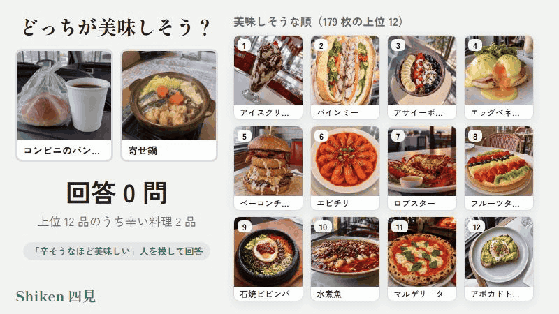
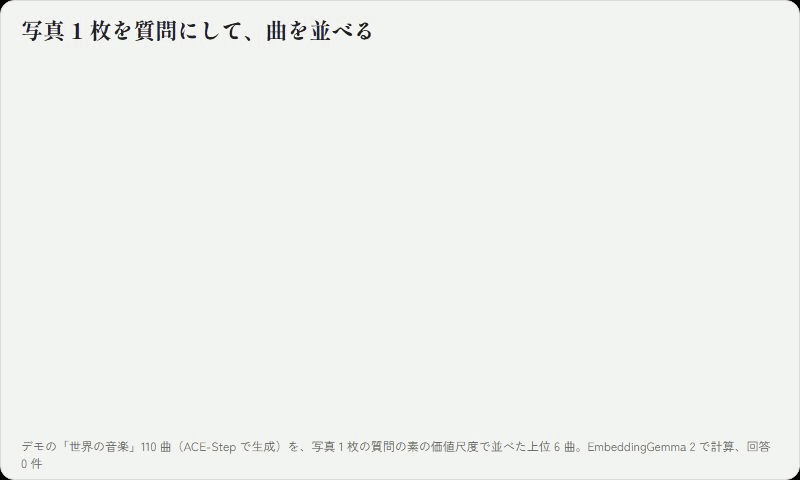
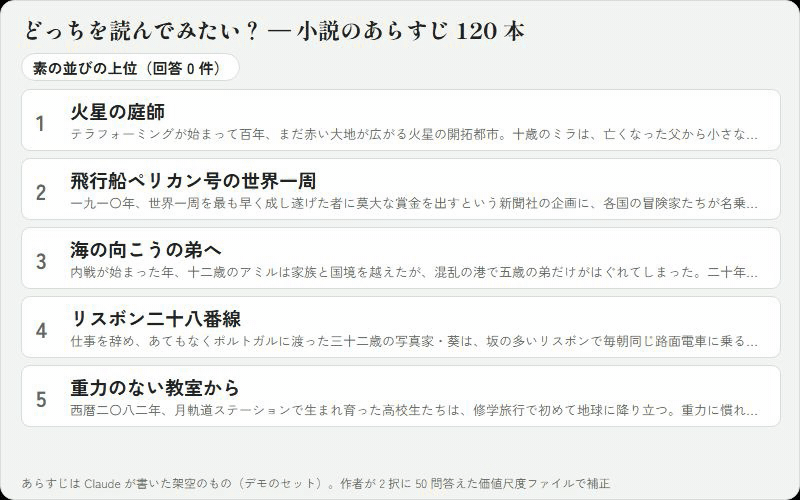
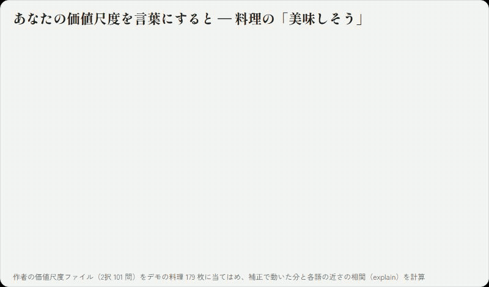
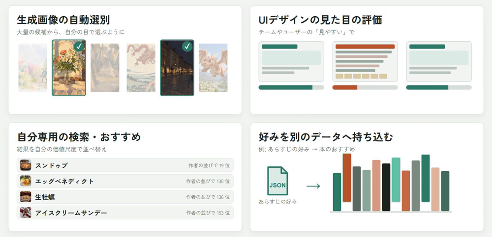

# Shiken（四見）



ブラウザで動くデモはこちら

https://shiken.mocchan.net/

## これは何？
**埋め込みモデル**を利用した、**パーソナライズ＆共有可能**なJevライク**マルチモーダルスコアリングシステム**です。


1. **マルチモーダルなスコアリング** Jevライクに、ある入力がある基準に対してどの程度かを評価します。絶対値としての正しさよりは、相対的な並び順の評価がメインです。
2. **自分の回答で、パーソナライズ** 素の評価は埋め込みモデルの持っている方向性ですが、これを補正することで自分だけの価値尺度を作ることができます。
3. **共有可能** 質問に答えて作ったあなたの価値尺度は、1つのファイルになります。モデルが同じならアプリを越えて使用可能で、他者と共有し合うことが出来ます。

スコアリングに必要なのは、埋め込みモデルに対象を通したベクトルだけ。埋め込みベクトルを計算し終えたあとのスコアリングやパーソナライズは numpy だけで動き、GPU も LLM の API も使いません。

## 何が出来る？
- 画像を、言語で評価する


- 音楽を、画像で評価する



- 言語を、言語で評価する



- 自分の価値基準を、言語化する



## 最小使用例（Python）

```python
import shiken
from shiken import Score
from shiken.encoders import EmbeddingGemma2   # pip install "shiken[eg2]"

enc = EmbeddingGemma2()
photos = ["dish01.jpg", "dish02.jpg", ...]
taste = shiken.Taste(
    question=Score([(1, "全然美味しくなさそうな料理の写真"),
                    (5, "最高に美味しそうな料理の写真")]),
    items=enc.embed_files(photos), ids=photos, encoder=enc,
)

taste.rank()                   # 回答 0 件: 素の埋め込みモデルが作る並び
a, b = taste.next_pair()       # 次に聞く組
taste.answer(a, b, prefer=a)   # 「a の方が美味しそう」
taste.rank()                   # 自分に合わせた並び
taste.save("my_taste.json")    # 価値尺度ファイル（自分の価値尺度を保存したファイル）
```

デフォルトで使用されているEmbeddingGemma-2以外の埋め込みモデル（SigLIP 2、Qwen3-VL-Embedding、Ovis-Embedding、Omni-Embed-Nemotron で動くことを確かめています）を使うこともできます。詳しくは [Python で使う](docs/python.md) と [埋め込みモデル](docs/embedding-models.md#ほかのモデルで確かめた結果)。

## ブラウザで使う（JavaScript）

データセットを埋め込みモデルで評価したベクトルのリストを Python で作っておけば、2 択の出題とパーソナライズはブラウザの中だけで済みます。回答をサーバーに送る必要もありません。詳しくは [JavaScript で使う](docs/javascript.md)。

## 考えられるアプリケーション



- **生成画像の自動選別**: 画像生成で作った大量の候補から、自分の目で選ぶように上位だけを残します。プロンプトを変えながら生成するループの「審判」にもできます。
- **UI デザインの見た目の評価**: 画面のスクリーンショットを、チームやユーザーの「見やすい」の価値尺度で採点します。デザインの案を比べたり、変更で見た目が悪くなっていないかを確かめたりできます。
- **自分専用の検索・おすすめ**: 検索やおすすめの結果を、自分の価値尺度で並べ替えます。価値尺度ベクトル（`weight_vector()`）を書き出せば、ベクトル検索のデータベースでそのまま並べ替えに使えます。
- **好みを別のデータへ持ち込む**: デモで作った価値尺度ファイルを、別のデータセットに当てはめます。作例として、デモの「小説のあらすじ」で作ったファイルで青空文庫の名作を並べる [`examples/aozora_classics.py`](examples/aozora_classics.py) と、デモの「絵」で作ったファイルでメトロポリタン美術館の所蔵品（パブリックドメイン）を並べる [`examples/met_paintings.py`](examples/met_paintings.py) があります。

## 文書

| 文書 | 内容 |
| :-- | :-- |
| [原理・仕組み](docs/concepts.md) | このシステムがどう動くのか |
| [質問の作り方](docs/questions.md) | スコアリングするための質問の作り方 |
| [Python で使う](docs/python.md) | Python の API |
| [JavaScript で使う](docs/javascript.md) | ブラウザでの使い方 |
| [価値尺度ファイルの形式](docs/profile-format.md) | 保存するファイルの中身と、個人のデータとしての扱い |
| [埋め込みモデル](docs/embedding-models.md) | 既定のモデル、ほかのモデルへの差し替え、ライセンス |
| [試した範囲での結果](docs/evaluation.md) | 題材ごとの、回答 0 問の当たり方と、何問答えるとどこまで合うか |
| [開発](docs/development.md) | リポジトリの構成、Python 版と JavaScript 版を一致させるテスト |
| [デモ](demo/README.md) | デモについて |
| [先行類似事例](docs/related-work.md) | 既存の似たようなツール・研究など |

## 名前について

Shiken（四見）は、仏教（唯識）の言葉「一水四見（いっすいしけん）」から取りました。同じ水でも、天人には宝石で飾られた地に、人には水に、魚には住みかに、餓鬼には膿や血に見える。見る者によって、同じものが違って見えるという意味です。同じ料理の写真でも、人によって「美味しそう」の並びが違うというのが、このシステムの出発点です。

もう一つ、「私見（しけん）」、つまり自分だけの見方とも掛けています。

## ライセンス

Apache-2.0 です。コードのライセンスと、既定の埋め込みモデル（EmbeddingGemma 2 は Gemma の利用規約）の規約は別に適用されます。
