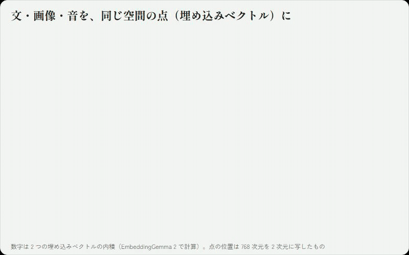
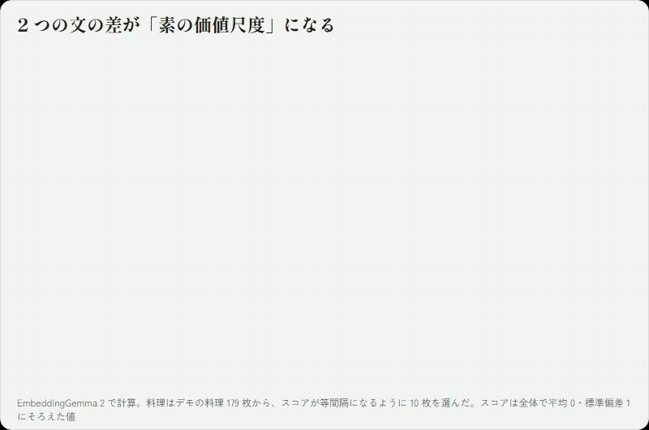

# 仕組み

日本語 | [English](en/concepts.md)

## 埋め込みモデル (Embedding Model)とは

埋め込みモデルは、文や画像などの入力を、決まった長さの数字の並び（埋め込みベクトル）に変換するモデルです。変換は、意味の近い入力どうしが近いベクトルになるように学習されています。「カレーライス」と「ハヤシライス」の文は近いベクトルに、「カレーライス」と「株価」は遠いベクトルになります。

文だけでなく、画像や音声も同じ空間に埋め込めるモデルがあります（マルチモーダル埋め込みモデル）。こうしたモデルでは、カレーの写真のベクトルと「カレーライス」という文のベクトルも近くなります。種類の違う入力どうしを、ベクトルの近さで直接比べられるということです。



Shiken が既定で使う EmbeddingGemma 2（EG2）は、Google が公開しているマルチモーダル埋め込みモデルです。文・画像・音声・動画を同じ 768 次元の空間に埋め込めます。7.4 億パラメータ（約 1.4 GB）と小さく、家庭用の GPU でも、時間をかければ CPU でも動きます。

## 埋め込みモデルによるスコアリング

2 つのベクトルの内積（成分ごとの積の合計）をとると、その 2 つがどれだけ近いかが 1 つの数で分かります。埋め込みモデルのよくある使い方は検索です。「海辺の夕焼け」という文のベクトルを作り、手持ちの写真のベクトルとの内積が大きい順に並べれば、文で写真を探せます。


EG2 そのものの説明は [Hugging Face のモデルカード](https://huggingface.co/google/embeddinggemma-2) にあります。

Shiken は、この仕組みをスコアリングに使います。「最高に美味しそうな料理の写真」と「全然美味しくなさそうな料理の写真」の 2 つの文をベクトルにし、その差をとると、空間の中に「美味しくなさそう → 美味しそう」という 1 本の向き、価値尺度のようなものができます。料理の写真のベクトルとこの「美味しくなさそう → 美味しそう」ベクトルの内積が、その写真の「美味しそう度」のスコアになります。

価値尺度を作る材料は、文でなくてもかまいません。同じ空間に埋め込めるものなら、画像や音を質問に使えます。たとえば写真を質問にして、音楽を評価することも原理上は出来ます(必ず有効とは限りませんが)。



ただし、埋め込みベクトルの近さは、モデルを学習させたときのデータ（Google が集めた大量の文や画像）の傾向を反映しています。文から作った価値尺度は、そのデータでの平均的な「美味しそう」で、全員に同じです。

個人に合わせるために埋め込みモデル自体を学習し直す（ファインチューニングする）方法もあります。しかし、それには 1 人あたり大量の回答と GPU での学習が要りますし、特定価値尺度へ最適化されて過ぎて本来持っていた判断力を失ってしまう(いわゆる破滅的忘却を起こす)可能性もあります。さらに、できあがるのは 1 人ごとに数 GB のモデルなので、ほかのアプリで使ったり、人と交換したりするのは現実的ではありません。

## Shikenの仕組み

Shiken は埋め込みモデルには手を加えず、その上の価値尺度（768 個の数字と、いくつかの係数）だけを本人の回答で補正します。流れは次のとおりです。

1. **質問を書く。** 文（または画像や音）で質問を書くと、モデル素の価値尺度ができます。この時点で、回答 0 件でもスコアリングできます。
2. **2 択に答える。** Shiken がデータセットから 2 つを選んで見せ、本人は質問により当てはまる方を選びます（「同じくらい」も選べます）。点数をつけてもらう代わりに 2 択にしているのは、人は絶対的な点数をつけるより、2 つを比べる方が答えがぶれにくいとされているからです。
3. **価値尺度を補正する。** 回答のたびに、価値尺度を本人の答えに合うように補正します。次に見せる 2 つも、答えを聞くと一番多くを学べる組を選びます。
4. **合ってきたかを確かめる。** Shiken は本人が答える前に、どちらが選ばれるかを予想しています。この予想が当たるようになってくれば、価値尺度が本人に合ってきたということです。
5. **ファイルにする。** 質問と回答の履歴を価値尺度ファイル（JSON）として保存します。同じ埋め込みモデルを使っていれば、別のアプリや別のデータセットでも、同じ価値尺度でスコアリングできます。人と交換することもできます。

価値尺度は空間の中の 1 本の向きなので、「傾向とは関係なく、この料理だけは好き」のような、その項目だけの好き嫌いは表せません。そこで Shiken は、答えに出てきた項目ごとの個別の加減点も別に持ちます。価値尺度は別のデータセットに持っていけますが、個別の加減点はその項目があるデータセットの中だけで使います。

補正のあとは、「辛い料理の方に寄った」「洋菓子を下げた」のように、価値尺度がどう補正されたかを言葉で表示できます。

## 実際のパーソナライズ処理

ここからは計算の中身です。

### 素の価値尺度と、回答 0 件での答え

質問は、選択肢ごとの説明（文・画像・音）で書きます。選択肢 k の説明の埋め込みを o_k、項目の埋め込みを s として、選択肢 k の確からしさを

```
z_k = (s · o_k − μ_k) / τ
```

とし、softmax で確率にします。μ_k は比較用の集合（既定ではデータセットそのもの）での s · o_k の平均で、どの項目にも似やすい説明の偏りを除くために引きます。τ は温度です。段階の質問（Score）では各段階の確率で段階の値の期待値を、選択の質問（Choice）では選択肢ごとの確率を、はい／いいえの質問（Noul）では当てはまる確率を返します。温度を正解つきのデータで決めない限り、確率の値そのものは目安で、意味があるのは並び順です。

パーソナライズに使う素の価値尺度 w0 は、段階の質問では段階の値（から平均を引いたもの）で重みづけした説明の埋め込みの和、はい／いいえの質問では「当てはまる」説明と「当てはまらない」説明の差です。

### 本人のスコアの形

本人のスコアを、素の価値尺度でのスコアと、そこからのずれの和で表します。

```
u(s) = a · u0(s) + Δwᵀ φ(s)
```

- u0(s) は、s · w0 を比較用の集合で標準化したもの（平均 0、標準偏差 1）です。
- a は、素の価値尺度をどれだけ残すかです。回答 0 件では a = 1 で、素の並びと同じになります。本人の答えが素の価値尺度と関係なければ、a は 0 に近づきます。
- φ(s) は、ずれを表すための項目の特徴です。概念の語（料理なら「揚げ物」「辛い」「盛り付けが美しい」など 98 語）との近さと、埋め込みベクトルそのもの（0.3 倍）を並べています。ずれ Δw が言葉で表せる概念の組み合わせに寄るので、少ない回答でも補正しやすくなります。φ からは u0 と同じ向きの成分を除いてあります。除かないと「a を大きくして Δw で打ち消す」解が選ばれ、Δw が本人のずれを表さなくなるためです。

### 回答の扱いと補正

2 択の回答は Bradley–Terry モデルで扱います。

```
P(a が選ばれる) = σ(u(a) − u(b))      σ はロジスティック関数
```

回答は 1（a）、0（b）、0.5（同じくらい）で記録します。a と Δw には「a は 1 のあたり、Δw は 0 のあたり」という事前分布を置くので、回答が少ないうちは素の価値尺度に近く、回答が増えるほど本人の答えに寄ります。回答のたびに、事後分布の最頻値をニュートン法で求め、その周りの広がりをラプラス近似で求めます。予想の確率はこの広がりを含めて計算するので、まだ自信のない組では 0.5 に近くなります。

### 次に聞く組

次に聞く組は、答えを聞いたときに価値尺度について得られる情報量が一番大きい組にします（BALD、Houlsby ら 2011）。おおまかには、価値尺度の候補どうしで予想が割れている組です。どちらが選ばれるか確信している組や、聞いても候補を絞れない組は選びません。

### 個別の加減点

答えに出てきた項目 k ごとに、加減点 ε_k を足します。

```
u(s_k) = a · u0(s_k) + Δwᵀ φ(s_k) + ε_k
```

ε_k の大きさ（事前分布の分散 s²）は、回答から自動で決めます。候補（0, 0.3, 1, 2, 4）ごとに補正し直し、回答をどれだけよく説明できるか（周辺尤度）を比べます。加減点なし（s² = 0）より対数で 1.0 以上よいときだけ加減点を使います。でたらめな回答でも、回答が少ないうちは周辺尤度が偶然 1 程度上がることがあるためです。同じ項目が何度も出題される小さなデータセット（数十曲の音楽など）では加減点が選ばれやすく、項目が多いデータセットでは選ばれません。

### 補正の中身の表示

比較用の集合の各項目について、補正で動いた分（u − a · u0）と各概念らしさの相関を計算し、相関の大きい語を並べます。Δw の成分をそのまま読まないのは、似た概念どうしで値を取り合い、個々の値の大きさが当てにならないためです。照らし合わせる語は、補正に使った概念の語に限りません。相関をとるだけなので、より大きな辞書や自分で用意した語のリストも使えます。データセットが無いときは、価値尺度ファイルに入っている答えた項目を比較用の集合の代わりにします。

### 価値尺度ファイルから作り直す

価値尺度ファイルには補正の結果ではなく、質問と回答（答えた項目の埋め込みベクトルを含む）を保存し、読み込むたびに補正し直します。保存した側と読み込む側で計算のしかたが変わっても、回答から作り直せるようにするためです。埋め込みモデルが違うと空間が別物になるので、その場合は保存した埋め込みベクトルを使いません。

### ブラウザでの計算

ブラウザ版も同じ事後分布を求めます。データセットの各項目の u0 と、事前分布の下での項目どうしのスコアの共分散を Python で前もって計算しておけば、補正は「回答数 × 回答数」の大きさの計算になります（ガウス過程分類のラプラス近似と同じ形）。個別の加減点は、この共分散に s² を足すことに当たります。100 問程度なら 1 回の補正は数ミリ秒です。
